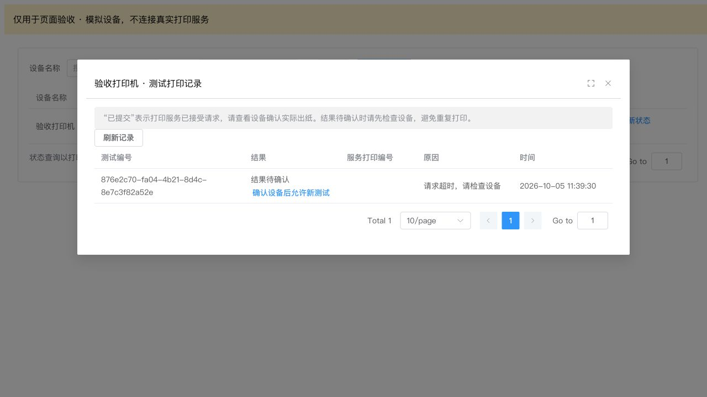

# 打印机管理：实现与交付说明

本次从 `develop` 的 `ca16926` 创建 `feature/printer-management`，恢复总部后台的打印机管理。第一版只注册易联云云端适配器，支持设备维护、启停、设备连接/取消授权、门店绑定、状态查询和测试小票，不接入订单打印。

## 404 的原因及修复

首页原来跳转 `/shop/web-print`，历史菜单却挂在 `/mall` 下；菜单 2308 和其按钮权限被软删除，且 `store/webPrint/index` 对应的页面不存在。后端也没有配套管理接口和设备表。

新页面为 `mall/store/printer/index`，正式地址 `/mall/web-print`。迁移恢复菜单 2308 和原有查询、新增、修改、删除权限，增加授权、门店绑定、测试权限。旧 `/shop/web-print` 仅在总部账号有查询权限、且新菜单已加载时重定向。首页入口和动态菜单对门店账号隐藏；后端每项操作仍检查独立权限和总部身份。

## 已完成的计划

- [x] 新建独立分支，定位菜单、路由、页面及接口缺失。
- [x] 通用设备、门店归属、授权状态及打印任务模型；提供重复执行的增量迁移。
- [x] 通用 `PrinterProvider` 接口和注册表，易联云适配器、凭证加密及接口超时处理。
- [x] 总部页面及接口：增删改查、启停、连接、绑定、状态、测试打印和记录。
- [x] 权限、身份隔离、并发绑定、重复提交及异常恢复测试；MySQL 8 迁移验收。
- [x] 前端类型检查、页面交互、生产构建，后端完整打包。
- [ ] 有易联云账号和实体设备后进行真实连接、状态和出纸验收。

## 扩展方式

调用链为 `PrinterController → PrinterService → PrinterProviderRegistry → PrinterProvider`。页面和业务服务只消费通用厂商说明、连接类型、配置字段和能力，易联云签名、访问令牌、协议字段及打印指令封装在 `yilianyun` 包中。

新增厂商实现 `PrinterProvider` 并注册为 Spring Bean，提供稳定的 `code`、配置字段和能力。状态映射成 `ONLINE / OFFLINE / PAPER_OUT / UNKNOWN`；打印接收通用 `Receipt`，适配器负责转换指令并返回服务打印编号。非云端连接也通过厂商提供的 `connectionTypes` 表达，不需要修改管理页面。未实现的能力声明为 false；业务层同样拒绝不支持的操作。

当前支持易联云自有型应用。第二个模拟厂商已通过相同业务服务完成保存、授权、绑定及测试打印，生产环境只注册易联云实现。

## 数据与状态约束

新增 `yshop_printer`、`yshop_printer_binding`、`yshop_printer_test_job`、`yshop_printer_provider_token` 四张表。设备按已验证登录身份的租户编号读写；存在租户上下文时要求编号一致，兼容当前关闭多租户过滤器的部署。现有门店表本身是共享表，没有租户列，本次沿用原有总部门店范围。

同一门店可绑定多台打印机，每台打印机只能属于一个门店。`provider_code + device_code` 全库唯一，包括软删除设备，防止同一物理设备被多个租户重复使用；同一租户重新添加已删除设备时恢复原记录。设备身份不能编辑。删除前必须解绑门店、确认取消授权；门店删除在同一事务中清理其打印机绑定，失败时整体回滚。

设备配置和应用访问令牌使用 AES-256-GCM 加密，包含随机 nonce 和上下文认证。详情只返回已配置的字段名，编辑留空保留原值；授权状态不明确时禁止更换密钥或删除。配置写入不记录请求内容，公共日志清洗也覆盖设备密钥和加密配置；外部原始响应不会进入错误或日志。

授权意图先落库再调用厂商，异常中断保留 `UNKNOWN`；一分钟内拒绝并发设备变更，之后允许管理员显式恢复。重连时先尝试查询已有设备状态，避免盲目重复注册。取消易联云授权调用官方解绑接口，对于自有型应用会解除开发者账号和设备的绑定。

测试请求先记录 `SUBMITTING`，再调用厂商。客户端同一次未确认请求复用编号，服务端唯一约束与设备锁保证重复请求不重复发送；易联云同时传入稳定 `origin_id` 和 `idempotence=1`。超时、响应异常或进程中断会标为 `UNKNOWN`，不会自动重试。长时间未结束的任务展示为待确认，管理员确认实体设备后才可主动发起新测试。“已提交”只代表云端接受请求，不代表设备实际出纸。

HTTP 连接超时 3 秒，单次请求（含响应体）最多 10 秒，响应体最多 64 KiB，不跟随重定向。设备名称、门店名称中的标签及旧版打印指令符号会被转换成普通文本。

## 部署顺序

1. 备份数据库，执行 `yshop-drink-boot3/sql/migrations/2026-10-05-printer-management.sql`。脚本适用于原始 MySQL 8/InnoDB 表结构，可以重复执行；不迁移旧 `uniprint_id`。
2. 部署新后端与前端。SQL 绕过菜单服务缓存，需通过现有缓存管理清理 `permission_menu_ids` 中 `store:web-print:*` 对应的缓存项。不要清空整个 Redis 数据库。
3. 给需要使用功能的总部角色分配菜单及按钮权限。超级管理员按现有机制获得所有权限，普通角色不会被自动扩权。用户退出并重新登录，刷新浏览器中的菜单缓存。
4. 暂无账号时保持打印服务关闭。可先维护设备与门店绑定，不填写终端密钥；数据库迁移仍需完成。
5. 获取易联云自有型应用及实体小票打印机后，在部署环境配置以下变量，再重启后端。变量值来自部署环境的秘密配置，不能提交到仓库。

| 变量 | 用途 |
| --- | --- |
| `YSHOP_PRINTER_ENABLED` | `true` 开启易联云接口，默认 `false` |
| `YILIAN_YUN_CLIENT_ID` | 易联云自有型应用 ID |
| `YILIAN_YUN_CLIENT_SECRET` | 易联云应用密钥 |
| `YSHOP_PRINTER_ENCRYPTION_KEY` | 独立的 32 字节随机密钥，Base64 编码 |

加密密钥必须持久保存并备份，不能在每次启动时重新生成，也不能直接替换已有密钥；替换需要迁移已加密的数据。设备终端号、终端密钥通过后台表单录入，密钥只写不读。

访问令牌按应用账号加锁获取并加密持久化，重启复用。采用官方自有型应用的长期令牌，不在每次请求时重新获取，避免消耗每日额度。若应用外部操作使令牌失效，先停止相关调用，由运维确认原因后清理对应 `yshop_printer_provider_token` 缓存记录，再显式重试；不要自动循环获取令牌。

回滚时关闭打印服务，并将菜单 2308 的 `status` 设为 1、清理对应权限缓存及重新登录；恢复旧版本应用。保留新增表、凭证密钥及测试记录，不执行删表回滚。新版本门店删除依赖绑定表，必须先完成迁移再部署。

## 验证证据与复现

已通过 26 项后端测试（16 项数据库/业务事务、3 项控制器权限与日志、7 项真实 HTTP 客户端协议测试），以及 3 项前端菜单权限测试。MySQL 8.0.46 的一次性数据库使用原始门店、菜单表定义执行同一迁移两次，并运行 16 项数据库测试；临时库及账号在结束后删除，现有开发数据库未使用。

前端类型检查、变更文件 ESLint、生产构建以及 `yshop-server` 完整打包通过。真实 Vue 页面在本机模拟接口下验证新增、未配置提示、门店绑定、授权、缺纸状态、超时及重复请求记录；两次测试点击只产生一条提交。页面验收使用模拟数据，未调用真实易联云设备。

```sh
# 从后端目录运行：H2 事务、权限及本机 HTTP 模拟接口
mvn -pl yshop-module-mall/yshop-module-store-biz -am test \
  -Dtest=PrinterDatabaseTest,PrinterControllerTest,YilianyunProviderTest \
  -Dsurefire.failIfNoSpecifiedTests=false

# 从仓库根目录运行：先安装前端项目依赖
node --test tests/printer/routes.test.mjs

# 使用已配置的本地 MySQL 环境；参数是保存 .local-dev/database.py 的工作区
python3 tests/printer/mysql-acceptance.py /path/to/local-workspace

# 从前端目录启动模拟页面；仅监听 127.0.0.1:5175
node tests/printer/preview.mjs
# 浏览器打开 http://127.0.0.1:5175/__printer-preview
```

生产验收需要实际设备验证中文、数字、金额显示及一份小票出纸，确认在线/离线/缺纸与厂商返回一致，并验证门店账号访问被拒绝。不同型号、固件及纸宽可能影响效果；不要将软件测试通过视为真机验收完成。



## 官方协议参考

2026-10-05 核对：[开发文档](https://doc2.10ss.net/#/md/开发文档)、[设备绑定](https://doc2.10ss.net/#/md/设备绑定)、[取消授权](https://doc2.10ss.net/#/md/设备解绑或取消授权)、[设备状态](https://doc2.10ss.net/#/md/状态获取)、[文本打印](https://doc2.10ss.net/#/md/文本打印)、[打印指令](https://doc2.10ss.net/#/md/指令集)。具体型号支持以厂商文档及真机验证为准。
